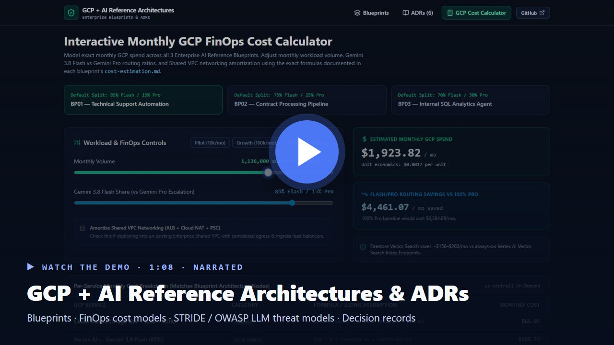

# Enterprise GCP + AI Reference Architectures & ADRs

> **Live Interactive Architecture Portal**: [https://gcp-ai-reference-architectures.vercel.app](https://gcp-ai-reference-architectures.vercel.app)  
> **Principal Cloud & AI Architecture Library** — 3 complete production GCP + Vertex AI blueprints, 12 verified Mermaid diagrams, 3-tier quantitative monthly GCP cost models, STRIDE & OWASP LLM Top 10 threat models, 6 MADR Architecture Decision Records, and an automated Mermaid + FinOps consistency test suite.

---

## Demo

[](https://github.com/SantiTN77/gcp-ai-reference-architectures/releases/download/v1.0.0/arch-demo.mp4)

**[▶ Watch the 1080p narrated demo](https://github.com/SantiTN77/gcp-ai-reference-architectures/releases/download/v1.0.0/arch-demo.mp4)** · **[Open the live app](https://gcp-ai-reference-architectures.vercel.app)**

## Executive Navigation Matrix

| Blueprint | Workload | Key GCP Services | Tiered Model Routing | Monthly Cost (Pilot / Growth / Enterprise) | Artifacts |
| :--- | :--- | :--- | :--- | :--- | :--- |
| **01** | **Enterprise Technical Support Automation** | Cloud Run v2, **Firestore Vector Search** ($0 idle), Cloud DLP, Model Armor, ADK, Cloud Armor, Cloud NAT + SWP, PSC, VPC-SC, CMEK | 85% Gemini 3.8 Flash / 15% Gemini Pro | **$84.25** / **$230.95** / **$1,705.92** | [Overview](./blueprints/01-technical-support-automation/README.md) &bull; [Cost](./blueprints/01-technical-support-automation/cost-estimation.md) &bull; [Threat Model](./blueprints/01-technical-support-automation/security-threat-model.md) |
| **02** | **Contract Processing & Risk Extraction Pipeline** | GCS (`raw`/`parsed`/`tokenized`), Eventarc, Cloud Workflows, Document AI, Cloud Run Jobs (Chunked DLP FPE + Extractor), Model Armor, Immutable Logging -> BigQuery Sink, CMEK, VPC-SC | 75% Gemini 3.8 Flash / 25% Gemini Pro | **$151.83** / **$1,116.95** / **$10,746.10** | [Overview](./blueprints/02-contract-processing-pipeline/README.md) &bull; [Cost](./blueprints/02-contract-processing-pipeline/cost-estimation.md) &bull; [Threat Model](./blueprints/02-contract-processing-pipeline/security-threat-model.md) |
| **03** | **Internal SQL Analytics Agent (MCP Read-Only)** | Cloud Run v2, ADK + **MCP Read-Only SQL Server** (AST Parser + `set_config` RLS + 10 GB BQ Dry-Run Cap), Cloud SQL RO Replica, BigQuery, IAP, Cloud DLP, Model Armor, PSC, Cloud Audit Logs | 70% Gemini 3.8 Flash / 30% Gemini Pro | **$111.10** / **$366.57** / **$1,377.53** | [Overview](./blueprints/03-internal-sql-analytics-agent/README.md) &bull; [Cost](./blueprints/03-internal-sql-analytics-agent/cost-estimation.md) &bull; [Threat Model](./blueprints/03-internal-sql-analytics-agent/security-threat-model.md) |

---

## Architecture Decision Records (`adrs/`)

All decisions follow the **MADR** format with quantitative trade-off matrices, exact break-even math, and explicit revisit triggers:

- [ADR-001: Cloud Run v2 (`min_instances=0`) over GKE Autopilot/Standard](./adrs/ADR-001-cloud-run-over-gke.md)
- [ADR-002: Cloud Firestore Vector Search ($0 idle) over Vertex AI Vector Search Index Endpoints](./adrs/ADR-002-firestore-vector-search-vs-vertex-ai-vector-search.md)
- [ADR-003: Per-Node Model Routing — Gemini 3.8 Flash vs Gemini Pro (-69.7% Enterprise LLM Spend)](./adrs/ADR-003-gemini-flash-vs-pro-model-routing.md)
- [ADR-004: Cloud DLP Inline & Deterministic KMS-Wrapped Anonymization Before LLM Calls](./adrs/ADR-004-cloud-dlp-sensitive-data-anonymization.md)
- [ADR-005: Zero-Trust Private IAM OIDC, Vercel BFF Pattern & VPC-SC Isolation](./adrs/ADR-005-private-iam-oidc-and-vpc-isolation.md)
- [ADR-006: Standardizing Tool Access via MCP and Agent Delegation via A2A](./adrs/ADR-006-mcp-and-a2a-enterprise-agent-interoperability.md)

---

## Recruiter & Principal Architect Quick-Tour (3 Minutes)

1. **Open the Live Interactive Portal**: [https://gcp-ai-reference-architectures.vercel.app](https://gcp-ai-reference-architectures.vercel.app)
2. **Inspect Interactive Mermaid Diagrams**: Visit `/blueprints/01-technical-support-automation`, `/blueprints/02-contract-processing-pipeline`, and `/blueprints/03-internal-sql-analytics-agent` (supports Zoom, Source view, and Copy).
3. **Model Custom FinOps Scenarios**: Visit `/calculator` to adjust workload volume, Flash/Pro routing ratios, and Shared VPC amortization in real time.
4. **Search Quantitative ADRs**: Visit `/adrs` to filter decisions by blueprint or technology.

---

## Automated Verification & Governance (`pnpm` Only)

```powershell
# Install devDependencies (strictly pnpm — zero npm / package-lock.json)
pnpm install

# Run full Mermaid v11 parser validation (12 diagrams) + cross-artifact consistency & cost-sum math (158 checks)
pnpm test

# Regenerate Architecture Audit Report
pnpm run audit:report

# Run working-tree secret & credential scan
powershell -ExecutionPolicy Bypass -File scripts/secret-scan.ps1
```

### Supporting Documentation
- [Independent Architecture Audit Report](./docs/ARCHITECTURE_AUDIT_REPORT.md)
- [3.5-Minute Demo Video Script](./docs/VIDEO_SCRIPT.md)
- [Live Demo Walkthrough](./docs/DEMO_WALKTHROUGH.md)
- [Independent Verification Guide](./docs/VERIFICATION.md)

## Author

**Daniel Tafur** — AI Agent Engineer · AI Solutions Architect (GCP)  
[LinkedIn](https://www.linkedin.com/in/danielsantiagotafur/) · [Portfolio](https://danieltafur.vercel.app)
