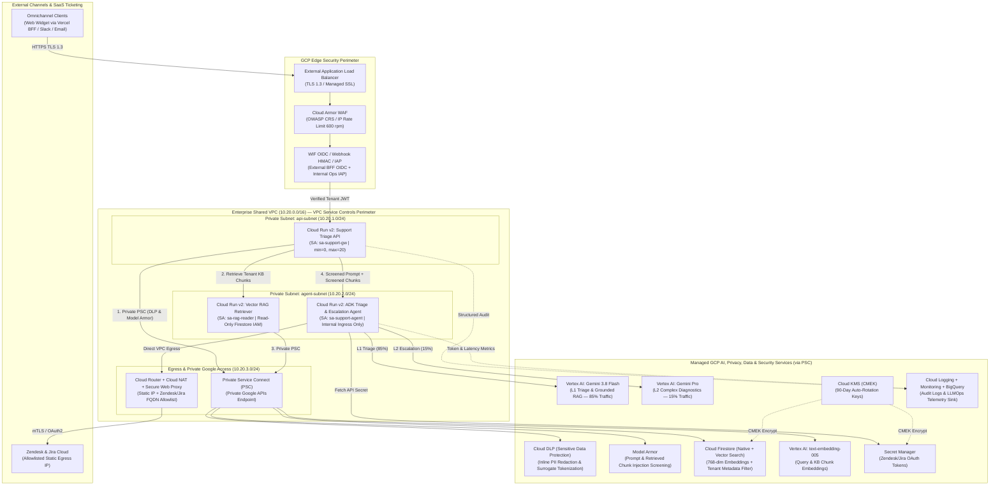
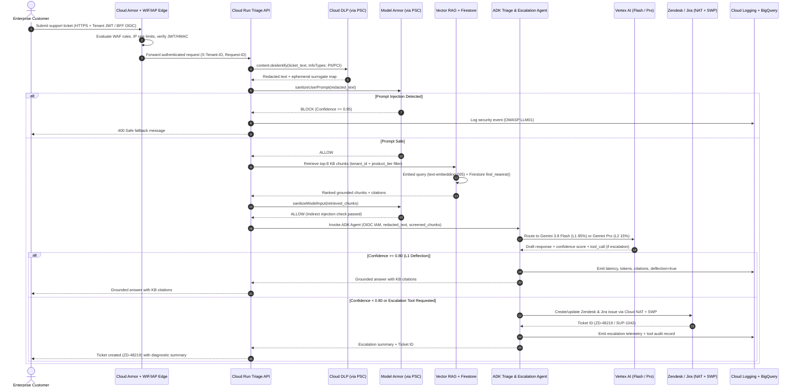

# Blueprint 01: Enterprise Technical Support Automation

## 1. Executive Summary

This blueprint defines a production-grade, zero-trust **Enterprise Technical Support Automation** architecture on Google Cloud Platform (GCP). It automates Level-1 (L1) ticket triage and knowledge-grounded resolution while orchestrating deterministic Level-2 (L2) escalations into Zendesk and Jira through an **Agent Development Kit (ADK)** tool-calling agent.

Key architectural properties:
- **Zero Idle Cost Compute & Vector Storage**: All stateless API, retrieval, and agent services run on **Cloud Run v2** (`min_instance_count = 0` for pilot/off-peak; optional warm instances for enterprise P99 latency SLAs), paired with **Cloud Firestore Vector Search** ($0 idle baseline; see [ADR-002](../../adrs/ADR-002-firestore-vector-search-vs-vertex-ai-vector-search.md)).
- **Privacy-by-Design LLM Pipeline**: Every inbound ticket passes through **Cloud DLP (Sensitive Data Protection)** inline de-identification and **Model Armor** prompt-injection screening *before* any token reaches **Vertex AI**.
- **Tiered Cost-Optimized Inference**: 85% of routine L1 inquiries route to **Gemini 3.8 Flash**; only the top 15% high-complexity diagnostic or multi-system escalations escalate to **Gemini Pro** (see [ADR-003](../../adrs/ADR-003-gemini-flash-vs-pro-model-routing.md)).
- **Strict Network Egress Governance**: Outbound calls to Zendesk and Jira traverse **Direct VPC Egress** and **Cloud NAT** with static allowlisted IP addresses; all Google API calls stay on Google's private backbone via **Private Service Connect (PSC)** inside a **VPC Service Controls (VPC-SC)** perimeter.

---

## 2. Business SLA & Technical SLO Targets

| Metric | Target SLO | Measurement Window | Enforcement Mechanism |
| :--- | :--- | :--- | :--- |
| **API Availability** | 99.95% | Rolling 30 days | Multi-zone Cloud Run v2 + External ALB health checks |
| **L1 Grounded Resolution Latency (P95)** | <= 2.8 s | Rolling 7 days | Gemini 3.8 Flash streaming + Firestore composite vector index |
| **L2 Escalation Latency (P95)** | <= 6.5 s | Rolling 7 days | Gemini Pro + bounded 3-step ADK tool loop (5s timeout/tool) |
| **L1 Autonomous Deflection Rate** | >= 62% | Monthly | Confidence threshold >= 0.80 + citation grounding verification |
| **PII Leakage to LLM Rate** | 0.00% | Continuous | Mandatory synchronous Cloud DLP gate (fail-closed on DLP error) |
| **Grounded Citation Fidelity** | >= 96% | Weekly eval batch | Automated Vertex AI Eval / NLI entailment check in BigQuery |
| **Idle Infrastructure Cost** | $0.00 / mo | Pilot / Non-prod | Cloud Run `min_instances = 0` + Firestore serverless vector index |

---

## 3. Network & Security Architecture

> Source: [architecture-diagram.mmd](./architecture-diagram.mmd)

### IAM Least-Privilege Matrix

| Service Account | Attached Service | Granted Roles (Scoped to Resource) | Explicitly Denied / Absent |
| :--- | :--- | :--- | :--- |
| `sa-support-gw` | Cloud Run Triage API | `roles/dlp.user`, `roles/modelarmor.user`, `roles/run.invoker` (on RAG & ADK only), `roles/logging.logWriter` | No Firestore read, no Secret Manager access, no direct internet egress |
| `sa-rag-reader` | Cloud Run Hybrid RAG | `roles/datastore.viewer` (read-only), `roles/aiplatform.user` (embedding endpoint only) | No Firestore write/delete, no Secret Manager, no external egress |
| `sa-support-agent` | Cloud Run ADK Agent | `roles/aiplatform.user`, `roles/secretmanager.secretAccessor` (scoped to `zendesk-oauth`, `jira-token` only), `roles/logging.logWriter` | No Firestore write, no IAM admin, no BigQuery read |

---

## 4. Runtime Request & Security Sequence

> Source: [sequence-diagram.mmd](./sequence-diagram.mmd)

---

## 5. Failure Modes & Resilience Patterns

| Failure Scenario | Blast Radius | Automated Mitigation | Recovery SLO |
| :--- | :--- | :--- | :--- |
| **Cloud DLP API timeout / 5xx** | Inbound triage halted | **Fail-closed** — never bypass DLP. Retry with exponential backoff (200ms, 500ms); after 2 retries, queue ticket to human Zendesk queue without LLM invocation. | < 2s fallback |
| **Vertex AI 429 Quota / Regional Degradation** | LLM synthesis degraded | Cross-region fallback (`us-central1` -> `us-east4`) with circuit breaker (open after 5 consecutive 5xx in 30s). | < 5s failover |
| **Firestore Vector Index Cold Latency** | Slight P95 spike | Pre-filter by `tenant_id` and `product_tier` composite index to restrict ANN search space to < 50k vectors per tenant. | P95 < 180ms |
| **Zendesk / Jira API Outage** | L2 escalation delayed | ADK escalation tool writes idempotent retry payload (`idempotency_key = sha256(ticket_id)`) to dead-letter Cloud Tasks queue with backoff up to 24h. | Zero ticket loss |
| **LLM Hallucination / Low Grounding** | Incorrect user guidance | Mandatory confidence threshold (`>= 0.80`) + strict citation regex check against retrieved Firestore document IDs; failing responses auto-escalate to L2. | 100% gated |

---

## 6. Observability & LLMOps KPIs

All Cloud Run services emit structured JSON logs to **Cloud Logging** with a BigQuery Log Sink (`llmops_support_events`) partitioned by `event_date` and clustered by `tenant_id`, `model_tier`:

- **Operational Metrics (Cloud Monitoring)**: Request rate, error rate (4xx/5xx), Cloud Run cold-start ratio, P50/P95/P99 latency per microservice, Cloud NAT port utilization.
- **LLMOps Metrics (BigQuery)**:
  - `deflection_rate = COUNTIF(escalated = FALSE) / COUNT(*)`
  - `cost_per_resolved_ticket = SUM(dlp_cost + embed_cost + llm_cost) / COUNTIF(escalated = FALSE)`
  - `pro_escalation_share` (target <= 15%; alerts if > 20% indicating prompt drift)
  - `model_armor_block_rate` (security anomaly alert if > 2% of tenant traffic)
- **Related Artifacts**:
  - [Monthly GCP Cost Estimation](./cost-estimation.md)
  - [STRIDE & OWASP LLM Top 10 Threat Model](./security-threat-model.md)
  - [ADR-001: Cloud Run over GKE](../../adrs/ADR-001-cloud-run-over-gke.md)
  - [ADR-002: Firestore Vector Search vs Vertex AI Vector Search](../../adrs/ADR-002-firestore-vector-search-vs-vertex-ai-vector-search.md)
  - [ADR-003: Gemini Flash vs Pro Model Routing](../../adrs/ADR-003-gemini-flash-vs-pro-model-routing.md)
  - [ADR-004: Cloud DLP Sensitive Data Anonymization](../../adrs/ADR-004-cloud-dlp-sensitive-data-anonymization.md)
