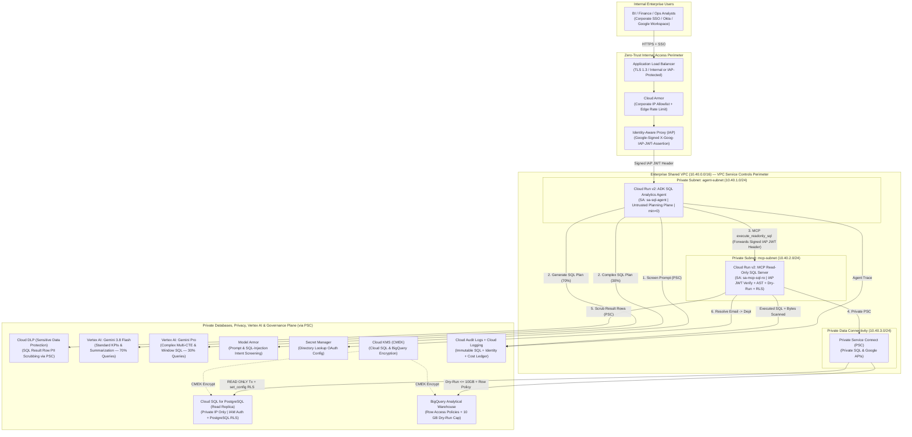
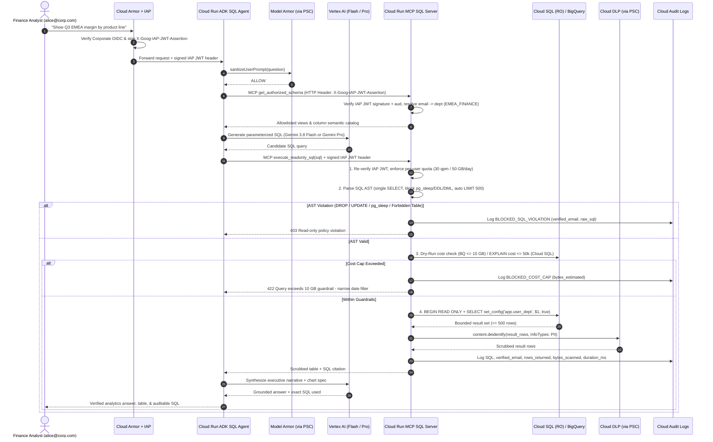

# Blueprint 03: Internal Enterprise Agent Connected to SQL Databases

## 1. Executive Summary

This blueprint defines a zero-trust, read-only **Internal Enterprise SQL Analytics Agent** on GCP that lets finance, operations, and BI teams query **Cloud SQL for PostgreSQL** and **BigQuery** in natural language — without ever exposing raw database credentials, risking destructive DDL/DML execution, leaking cross-department rows, or triggering runaway BigQuery scan bills.

Key architectural properties:
- **Standardized MCP Read-Only Tool Server**: Database access is strictly isolated inside a dedicated **Model Context Protocol (MCP)** server running on private **Cloud Run v2** (`sa-mcp-sql-ro`; see [ADR-006](../../adrs/ADR-006-mcp-and-a2a-enterprise-agent-interoperability.md)). The ADK agent has **zero direct network or IAM path** to Cloud SQL or BigQuery.
- **Deterministic SQL AST Guardrails (Zero LLM Trust)**: Every LLM-generated query is parsed into an Abstract Syntax Tree (AST) before touching any database. Anything other than a single `SELECT` / `WITH ... SELECT` against allowlisted semantic views is hard-blocked; `LIMIT 500` and `statement_timeout = 8s` are injected deterministically.
- **Identity Propagation & Row-Level Security (RLS)**: Verified **Identity-Aware Proxy (IAP)** user claims (`email`, `department`) are propagated into PostgreSQL `SET LOCAL app.user_dept` inside a `BEGIN TRANSACTION READ ONLY` block and into BigQuery Row Access Policies — eliminating confused-deputy data leaks.
- **Query Cost Dry-Run Gate & Output PII Scrubbing**: BigQuery queries execute `dryRun = true` first and reject any scan > 10 GB; outbound SQL rows pass through **Cloud DLP** to scrub unexpected PII embedded in free-text note columns before reaching Vertex AI synthesis.

---

## 2. Business SLA & Technical SLO Targets

| Metric | Target SLO | Measurement Window | Enforcement Mechanism |
| :--- | :--- | :--- | :--- |
| **Analytics Agent Availability** | 99.90% (Business Hours) | Rolling 30 days | Cloud Run v2 + Cloud SQL HA Read Replica + BigQuery |
| **End-to-End Query Latency (P95)** | <= 5.5 s | Rolling 7 days | Gemini 3.8 Flash (70% queries) + 8s SQL statement timeout |
| **Destructive SQL Execution Rate (DDL/DML)** | 0.00% (Hard Zero) | Continuous | Triple barrier: SQL AST parser + `READ ONLY` tx + DB read-only role |
| **Cross-Department RLS Leakage** | 0.00% (Hard Zero) | Continuous | IAP JWT propagation + DB-native RLS & BigQuery Row Access Policies |
| **Max Single-Query BigQuery Scan** | <= 10 GB ($0.05 cap) | Per query | Mandatory BigQuery `dryRun = true` gate in MCP server |
| **SQL Execution Accuracy (Valid & Correct)** | >= 93% | Bi-weekly golden set | Semantic catalog grounding + 1 automated syntax self-correction retry |

---

## 3. Network & Security Architecture

> Source: [architecture-diagram.mmd](./architecture-diagram.mmd)

### IAM Least-Privilege Matrix

| Service Account | Attached Service | Granted Roles (Scoped to Resource) | Explicitly Denied / Absent |
| :--- | :--- | :--- | :--- |
| `sa-sql-agent` | Cloud Run ADK Agent | `roles/aiplatform.user`, `roles/modelarmor.user`, `roles/run.invoker` (on MCP server only) | **Zero** Cloud SQL IAM, **zero** BigQuery IAM, **zero** Secret Manager access |
| `sa-mcp-sql-ro` | Cloud Run MCP Server | `roles/cloudsql.client` + `roles/cloudsql.instanceUser` (DB role `analytics_ro` with `SELECT` on views only), `roles/bigquery.jobUser` + `roles/bigquery.dataViewer` (curated dataset only), `roles/dlp.user`, `roles/secretmanager.secretAccessor` (directory OAuth config only) | No `INSERT`/`UPDATE`/`DELETE`/`DROP`, no raw operational tables, no internet egress |

---

## 4. Runtime Request & Security Sequence

> Source: [sequence-diagram.mmd](./sequence-diagram.mmd)

---

## 5. Failure Modes & Resilience Patterns

| Failure Scenario | Blast Radius | Automated Mitigation | Recovery SLO |
| :--- | :--- | :--- | :--- |
| **LLM Generates Invalid SQL Syntax** | Single analyst query | MCP server returns structured PostgreSQL/BigQuery parse error; ADK agent executes max **1 bounded self-correction retry** before returning helpful clarification prompt. | < 3 s retry |
| **Expensive Full-Table BigQuery Scan** | FinOps budget | Mandatory `dryRun = true` check rejects any query > 10 GB before execution and advises analyst to add a partition date filter (`WHERE event_date >= ...`). | 0 bytes billed |
| **Cloud SQL Read Replica CPU Saturation** | Slow operational queries | Connection pool cap (`max_connections = 20` per Cloud Run instance) + `statement_timeout = 8000ms` + automatic fallback notice directing heavy historical queries to BigQuery. | Primary DB 100% isolated |
| **Unstructured Column Contains Unexpected PII** | Data governance | Synchronous **Cloud DLP** scans serialized SQL result rows before returning them to ADK or rendering to the analyst. | 100% scrubbed |

---

## 6. Observability & LLMOps KPIs

- **Governance & Audit (Cloud Audit Logs + Cloud Logging)**: Every executed SQL statement is logged alongside `user_email`, `user_dept`, `ast_verified = true`, `bytes_scanned`, `rows_returned`, and `dlp_redactions_count`.
- **Analytics Quality KPIs**:
  - `first_pass_sql_valid_rate` (target >= 93%)
  - `ast_blocked_attempts` (security alert on any DML/DDL attempt)
  - `avg_bq_mb_per_query` (FinOps efficiency metric)
- **Related Artifacts**:
  - [Monthly GCP Cost Estimation](./cost-estimation.md)
  - [STRIDE & OWASP LLM Top 10 Threat Model](./security-threat-model.md)
  - [ADR-001: Cloud Run over GKE](../../adrs/ADR-001-cloud-run-over-gke.md)
  - [ADR-005: Private IAM OIDC & VPC Isolation](../../adrs/ADR-005-private-iam-oidc-and-vpc-isolation.md)
  - [ADR-006: MCP & A2A Enterprise Agent Interoperability](../../adrs/ADR-006-mcp-and-a2a-enterprise-agent-interoperability.md)
